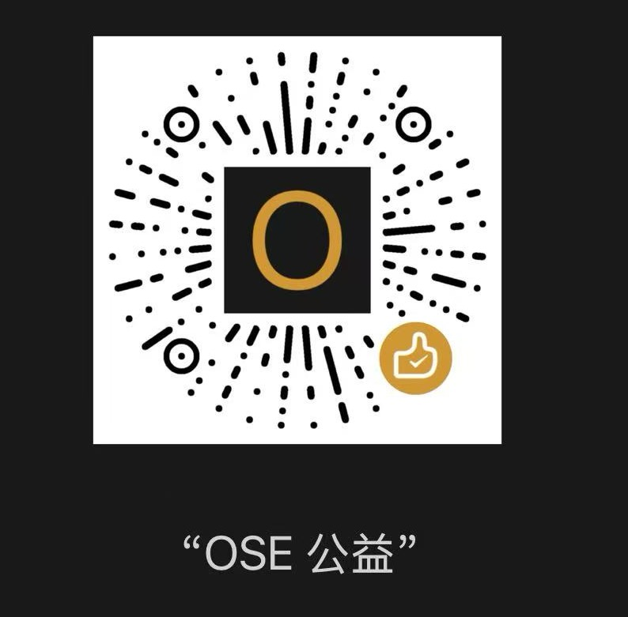

# 公文格式排版与标题写作 ｜ Chinese Official Document Layout & Title Writing

**从文种判断、标题拟写到 Word/WPS 版式核验的 Codex 技能。**  
**A Codex skill for document classification, title drafting, Word/WPS formatting, and editorial review.**

[中文介绍](#中文介绍) · [English overview](#english-overview) · [安装与调用 / Install and use](#安装与调用--install-and-use)

## 中文介绍

适用于党政机关公文校样，以及事业单位、高校、社会组织和企业的正式材料。可从一份已有文稿入手检查文种与版式，也可根据事项、受文对象和拟办理结果，提供可直接使用的标题。处理既有文稿时，可限定为格式修改，并核对正文、附件和落款是否完整保留。

| 能力 | 可处理事项 |
| --- | --- |
| 文种判断 | 识别通知、请示、报告、批复、函、通报、纪要等适用场景，核对机关关系和办理目的。 |
| 标题拟写 | 覆盖印发、批转、转发、请示审批、情况报送、公开周知等场景，核对发文机关、事由和文种。 |
| 材料拟题 | 为方案、总结、调研报告、验收材料拟主标题和章节小标题。 |
| 版式核查 | 核对 A4 版心、字体和字号、断行、层级、主送、附件、版记及单双页页码，识别信函、命令和纪要的式样差异。 |
| 电子文件命名 | 按项目、事项、日期和真实版本状态规范文件名，便于送审和归档检索。 |
| 双语标题 | 按需给出中英对照，保留事由和办理动作，并提示核对机关正式译名。 |

可交付标题建议、逐项审校清单或排版后的可编辑副本。页面核验依赖实际字体和渲染环境，审校结果会说明待确认项。

## English overview

This skill supports official documents issued by Chinese Party and government organs, as well as formal materials prepared by public institutions, universities, nonprofit organizations, and businesses. It uses the relationship between the issuing and receiving bodies and the intended disposition of the matter to guide title drafting and review.

- **Document classification and titles.** Review notices, reports, requests for approval, approval replies, official letters, circulars, and minutes. Check titles for issuing authority, subject, and document type.
- **Editorial structure.** Draft titles and section headings for work plans, summaries, research reports, and project acceptance materials.
- **Layout and preflight.** Inspect page geometry, typography, semantic title wrapping, addressees, appendices, imprint information, and page numbering. Account for special formats such as official letters, orders, and minutes.
- **File naming and bilingual titles.** Create searchable filenames with traceable draft status and provide English title equivalents where requested.
- **Deliverables.** Produce ready-to-use title options, an itemized review, or an editable formatted copy. Visual verification depends on the available fonts and rendering tools.

## 安装与调用 / Install and use

将仓库克隆到 Codex 用户技能目录。  
Clone the repository into your Codex user skills directory.

```bash
git clone https://github.com/yuehanaosi/official-document-formatting-skill.git \
  "${CODEX_HOME:-$HOME/.codex}/skills/official-document-formatting"
```

在 Codex 中调用 `$official-document-formatting`。若技能列表尚未刷新，可重新打开 Codex。  
Invoke `$official-document-formatting` in Codex. Reopen Codex if the skill has not appeared.

### 使用示例 / Example prompts

- **审题 / Title review**  
  核对这份申请增设服务窗口的文件应采用请示还是函，给出推荐标题并注明判断依据。  
  Determine whether this proposed service-counter expansion calls for a request for approval or an official letter. Suggest a title and explain the basis.
- **排版 / Formatting**  
  按单位模板调整附件中的 Word 文档，只改格式。核对首页正文、跨页标题、落款和附件页码。  
  Apply the supplied Word template while preserving the text. Check first-page body text, headings across page breaks, the signature and date block, and appendix pagination.
- **双语及归档 / Bilingual titles and filenames**  
  为档案目录核查方案拟一个正式标题及英文对照，另给送审稿文件名。  
  Draft a formal Chinese title and English equivalent for an archival inventory verification plan, plus a review-draft filename.

## 技能文件 / Skill files

- [SKILL.md](SKILL.md) · 任务识别和工作流程 / Task routing and workflow
- [标题与文件名 / Titles, headings and filenames](references/titles.md) · 文种判断、用词和示例 / Genre selection, wording, and examples
- [版式与校验 / Layout and preflight](references/layout.md) · 通用版式、特定式样和交付检查 / Standard and special layouts, plus delivery checks
- [agents/openai.yaml](agents/openai.yaml) · Codex 显示名称和调用示例 / Codex display name and sample invocation

## 参考依据 / References

- [GB/T 9704—2012《党政机关公文格式》](https://openstd.samr.gov.cn/bzgk/std/newGbInfo?hcno=F3CC9BEF482524C895FDA7A08BB4A70E)
- [《党政机关公文处理工作条例》 / Regulations on official document handling](https://www.miit.gov.cn/xwdt/szyw/art/2020/art_6afb8ee6d07540dcacccbeb47dbc0fd4.html)

## 扫码访问与支持 / Scan to visit or support

| GitHub 仓库 / Repository | OSE 微信赞赏 / WeChat appreciation |
| :---: | :---: |
|  |  |
